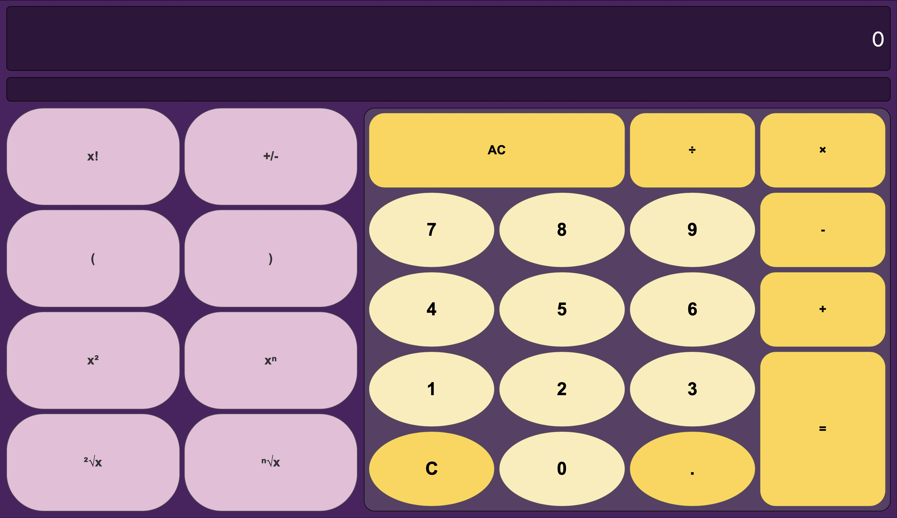
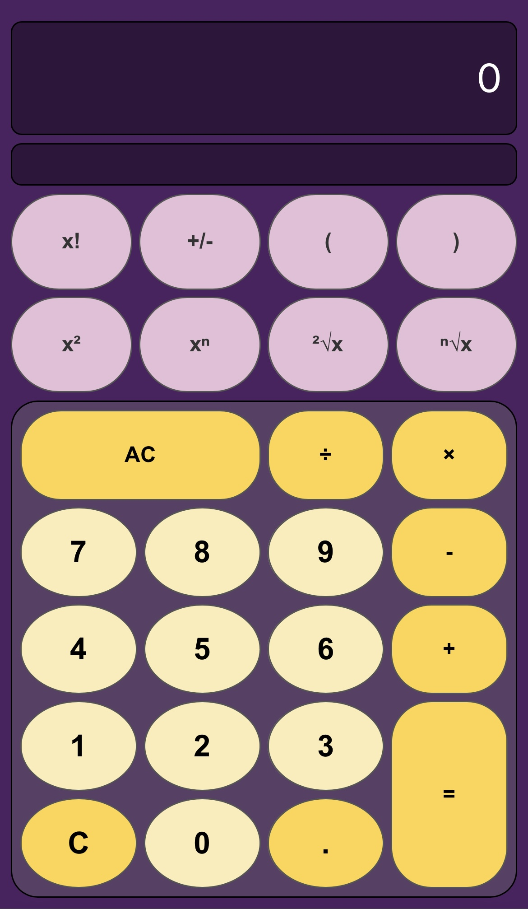

# Calculator

## Overview

A responsive calculator built using HTML, CSS and vanilla JavaScript.
The calculator uses a custom parser to evaluate mathematical expressions instead of relying on JavaScript's `eval()` function. 

## Technologies

* HTML5
* CSS3
* JavaScript

## Features 

* Basic arithmetic operations: addition, subtraction, multiplication and division;
* Advanced mathematical operations: factorial, powers and roots;
* Evaluates expressions containing multiple terms;
* Error handling for invalid expressions and mathematical operations;
* Responsive interface for desktop and mobile devices;
* Keyboard input support.

## What I Practiced

* Implementing mathematical logic in JavaScript;
* Parsing and evaluating mathematical expressions;
* Handling user input and invalid operations;
* Creating responsive layout using CSS Grid and media queries.

## How to View

You can view the live demo here:  
👉 **[Calculator](https://vaivaeva201.github.io/Calculator/)**

Or locally by opening `index.html` in a web browser.

## Preview

